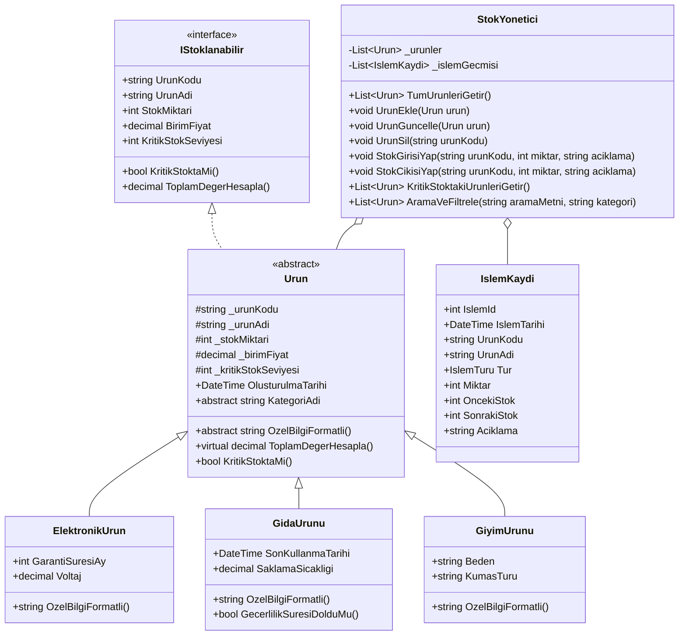
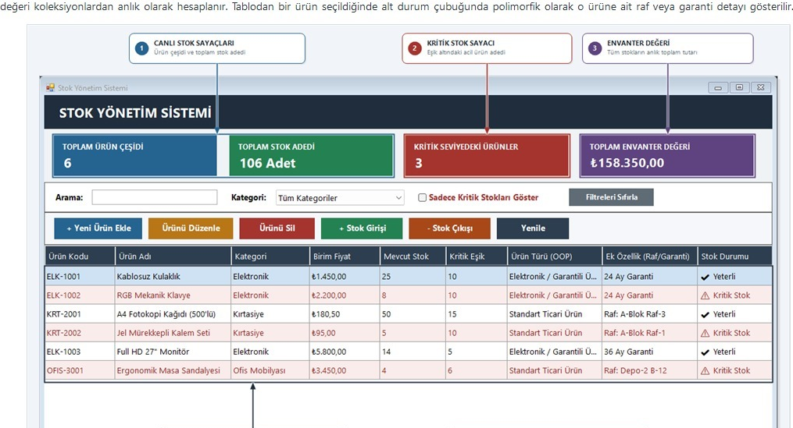
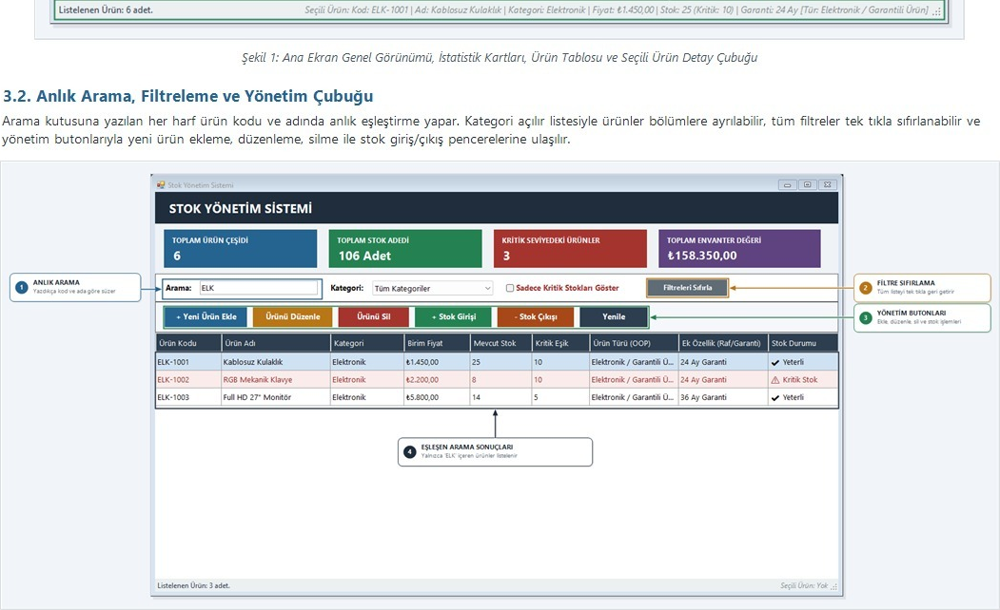
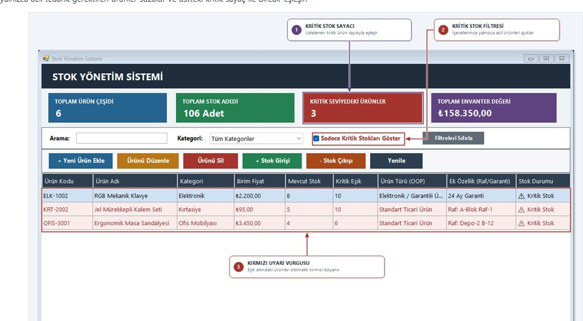
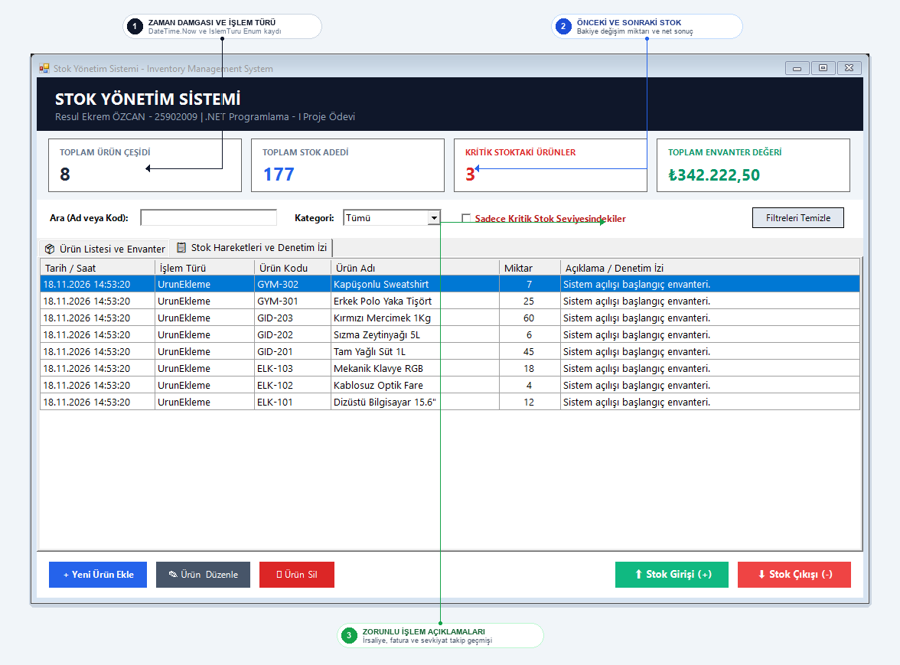
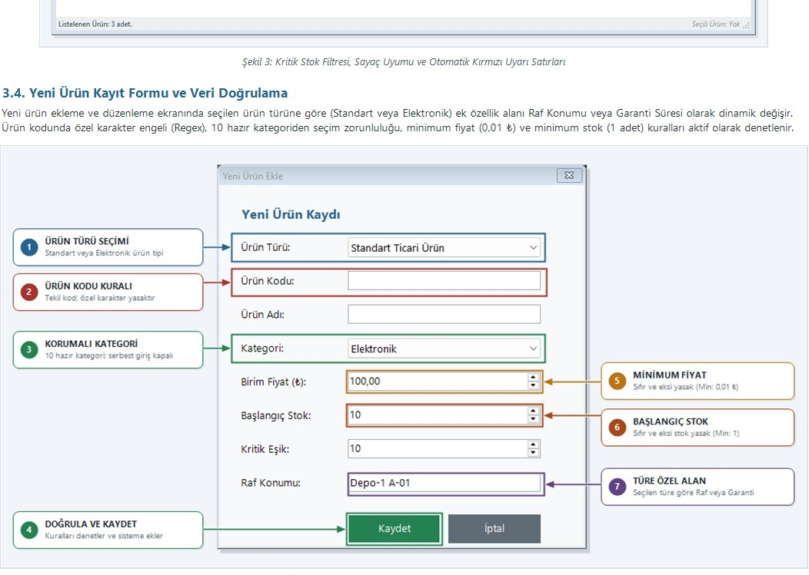
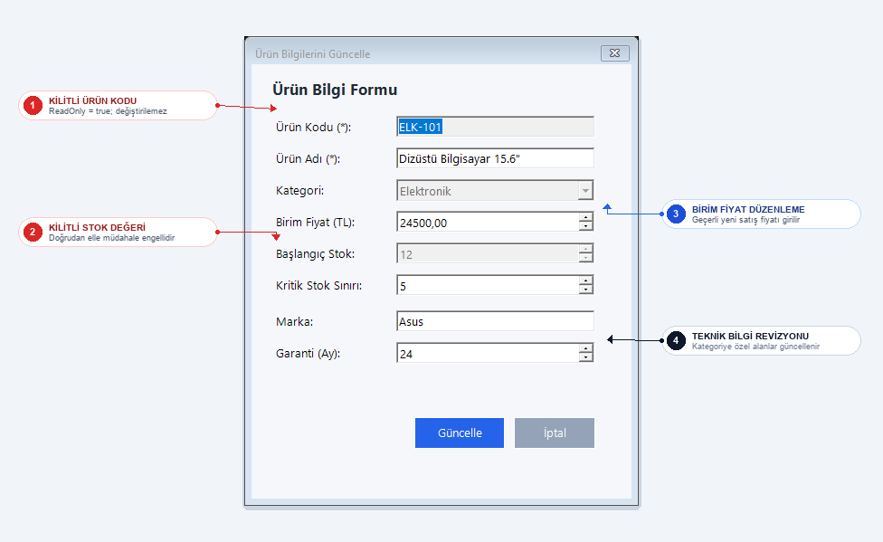
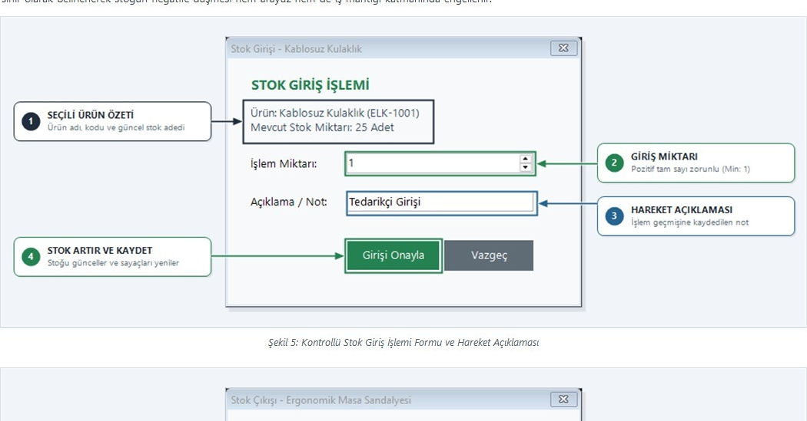
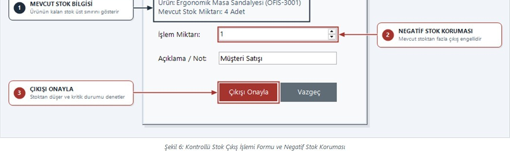

# 📦 STOK YÖNETİM SİSTEMİ (INVENTORY MANAGEMENT SYSTEM)
**İstanbul Gelişim Üniversitesi — .NET Programlama - I Dersi Dönem Projesi**

---

## 👨‍🎓 Öğrenci ve Proje Bilgileri
- **Öğrenci Adı Soyadı:** Resul Ekrem ÖZCAN
- **Öğrenci Numarası:** `25902009`
- **Ders:** .NET Programlama - I (BGT331 / BST301)
- **Ders Sorumlusu:** Dr. Öğr. Üyesi Tohid YOUSEFİ
- **Platform & Teknoloji:** C# .NET Framework 4.8, Windows Forms (WinForms)
- **Mimari:** Katmanlı Mimari (N-Tier), Nesne Yönelimli Programlama (OOP - Encapsulation, Inheritance, Polymorphism, Abstraction)
- **Veri Saklama:** Bellek İçi Generic Koleksiyonlar (`List<T>`) — *Ödev kuralları gereği harici SQL/veritabanı kullanılmamıştır.*

---

## 🌟 Proje Özeti ve Kapsamı
Bu proje, modern bir işletmenin stok yönetim ihtiyaçlarını karşılamak üzere geliştirilmiş, endüstriyel standartlarda validasyon ve hata yakalama mekanizmalarına sahip kurumsal bir masaüstü uygulamasıdır. 

Sistem üzerinde **Elektronik**, **Gıda** ve **Giyim** olmak üzere 3 farklı ürün kategorisi polimorfik olarak yönetilmekte; stok giriş ve çıkış hareketleri çift taraflı bakiye doğrulamasıyla denetlenmekte ve gerçekleştirilen tüm operasyonlar zaman damgalı **Denetim İzi (Audit Log)** tablosunda şeffaf bir şekilde kayıt altına alınmaktadır.

---

## 🏛️ Nesne Yönelimli Programlama (OOP) Mimarisi



### 1. Kapsülleme (Encapsulation)
- Tüm sınıf alanları (`fields`) `private` veya `protected` tanımlanmıştır.
- `BirimFiyat <= 0` veya `KritikStokSeviyesi < 0` girildiğinde `ArgumentException` tetiklenir.
- Ürün adlarındaki SQL Injection, XSS ve zararlı karakterler (`< > ; @ # $`) engellenirken ticari standart karakterler (`" ' % / . , -`) korunmuştur.

### 2. Kalıtım (Inheritance)
- `ElektronikUrun`, `GidaUrunu` ve `GiyimUrunu` sınıfları ortak alanları (`UrunKodu`, `UrunAdi`, `BirimFiyat`, `StokMiktari`) `Urun` temel sınıfından `base(...)` constructor'ı ile miras alır.

### 3. Çok Biçimlilik (Polymorphism)
- Temel sınıftaki `abstract string OzelBilgiFormatli()` metodu her alt sınıfta `override` edilerek türe özgü bilgiler (Garanti/Voltaj, SKT/Sıcaklık, Beden/Kumaş) dinamik olarak tek bir grid üzerinde listelenir.

### 4. Soyutlama (Abstraction)
- `IStoklanabilir` arayüzü ve `Urun` soyut sınıfı ile stok hareket kuralları ve sözleşmeleri katı bir biçimde tanımlanmıştır.

---

## 📸 Uygulama Ekran Görüntüleri ve İşlev Rehberi

Uygulamanın her bir aktivitesi ve işlevi aşağıda yönlendirme okları ve açıklama diyalog kartlarıyla detaylı olarak belgelenmiştir:

### Aktivite 1: Ana Ekran ve Yönetim Kontrol Paneli (Dashboard)
Uygulama açılışında kullanıcıyı modern, responsive ve genişleyebilir bir çalışma alanı karşılar.



- **1. KPI İstatistik Kartları:** Toplam ürün çeşidi, toplam stok adedi, toplam envanter mali değeri ve kritik stoktaki ürün sayısı anlık olarak hesaplanır ve dinamik kartlarda gösterilir.
- **2. Canlı Arama ve Kategori Filtreleme:** Arama kutusuna yazılan metne ve seçilen kategoriye göre grid eş zamanlı filtrelenir.
- **3. CRUD İşlem Butonları:** "Yeni Ürün Ekle", "Seçili Ürünü Düzenle" ve "Ürünü Sil" butonları ile temel ürün yönetimi sağlanır. Silme işleminde onay penceresi açılır.
- **4. Stok Giriş / Çıkış Butonları:** Ekranın sağ alt paneline dengeli yerleştirilen butonlar, pencere tam ekran yapıldığında grid ve buton oranlarını koruyacak şekilde hizalanır.

---

### Aktivite 2: Canlı Arama ve Kategori Filtreleme İşlevi
Yüzlerce ürün arasından istenilen kaleme anında ulaşmayı sağlayan çok kriterli arama mekanizmasıdır.



- **1. Metin Tabanlı Arama:** Arama kutusuna örneğin `"Fare"` yazıldığı anda ürün adı ve ürün kodu içinde `IndexOf(..., StringComparison.OrdinalIgnoreCase)` mantığıyla anında filtreleme uygulanır.
- **2. Filtrelenmiş Grid Görünümü:** Yalnızca kriterle eşleşen ürünler anında tabloda kalır; eşleşmeyen satırlar gizlenir.
- **3. Eş Zamanlı KPI Senkronizasyonu:** Tablodaki filtre değiştikçe üst paneldeki aktif ürün ve stok sayıları dinamik olarak filtrelenen sonuca adapte olur.

---

### Aktivite 3: Kritik Stok Uyarı Sistemi ve Görsel Vurgulama
Depodaki ürünlerin tükenmesini önlemek amacıyla geliştirilen görsel erken uyarı mekanizmasıdır.



- **1. Kritik Stok Filtreleme Kutusu:** "Sadece Kritik Stok Seviyesindeki Ürünleri Göster" seçeneği işaretlendiğinde `StokMiktari <= KritikStokSeviyesi` koşulunu sağlayan ürünler süzülür.
- **2. Kırmızı Renkli Görsel Vurgulama:** `RowPrePaint` olayında kritik seviyedeki ürün satırları açık kırmızı arka plan (`#FFD2D2`) ve koyu kırmızı metin rengiyle otomatik olarak renklendirilir.
- **3. Kritik Stok Uyarı Sayacı:** Üst paneldeki "Kritik Stok" kartı anında kırmızı renkle güncellenerek depocuyu ve yöneticileri uyarır.

---

### Aktivite 4: Denetim İzi ve Hareket Geçmişi (Audit Log)
Sistemde gerçekleşen her stok operasyonunun zaman damgalı olarak geriye dönük izlenebilirliğini sağlar.



- **1. Zaman Damgalı İşlem Listesi:** Her işlem `DateTime.Now` ile milisaniyesine kadar kayıt altına alınır.
- **2. İşlem Türü (Enum):** `IslemTuru` numaralandırıcısı ile "Giris", "Cikis" veya "Guncelleme" operasyonu net olarak listelenir.
- **3. Önceki ve Sonraki Stok Değerleri:** İşlem anındaki başlangıç stoğu, hareket miktarı ve sonuç bakiyesi matematiksel tutarlılıkla saklanır.
- **4. Zorunlu Açıklama Alanı:** İşlemi gerçekleştiren personelin girdiği irsaliye, fatura veya sevkiyat açıklaması denetim amacıyla görüntülenir.

---

### Aktivite 5: Kategoriye Özel Dinamik Ürün Ekleme (Elektronik Örneği)
Polimorfik yapı sayesinde seçilen kategoriye göre dinamik giriş alanları açan ürün kayıt formudur.



- **1. Zorunlu Temel Alanlar:** Ürün kodu, ürün adı, başlangıç stoğu, birim fiyat ve kritik stok seviyesi eksiksiz doldurulmalıdır.
- **2. 0 TL ve Mantıksız Değer Koruması:** `Birim Fiyat <= 0` girilemez, kuruş hanesi virgül/nokta ile desteklenir.
- **3. Kategoriye Özel Dinamik Panel:** Kategori "Elektronik" seçildiğinde Garanti Süresi (Ay) ve Voltaj (V); "Gıda" seçildiğinde SKT ve Sıcaklık; "Giyim" seçildiğinde Beden ve Kumaş panelleri dinamik olarak görüntülenir.
- **4. Kaydet Butonu ve Validasyon Kontrolü:** Eksik veya hatalı bilgi girildiğinde işlem engellenir ve kullanıcıya anlaşılır hata mesajı verilir.

---

### Aktivite 6: Mevcut Ürün Bilgilerini Güncelleme Ekranı
Var olan bir ürünün fiyat, kritik eşik ve kategoriye özel teknik verilerini güncelleyen ekrandır.



- **1. Salt Okunur (Read-Only) Ürün Kodu:** Veri bütünlüğünü korumak adına benzersiz ürün kodu düzenleme modunda kilitlidir, değiştirilemez.
- **2. Kilitli Başlangıç Stoğu:** Mevcut stok miktarı doğrudan formdan elle değiştirilemez; yalnızca resmi "Stok Giriş" veya "Stok Çıkış" fişleriyle hareket görebilir.
- **3. Fiyat ve Teknik Bilgi Güncelleme:** Birim fiyat, kritik seviye ve kategoriye özel parametreler güncellenerek sisteme kaydedilir.

---

### Aktivite 7: Güvenli Stok Girişi İşlemi
Tedarikçiden gelen yeni partilerin depoya kabulünü sağlayan kontrollü stok artırma ekranıdır.



- **1. İşlem Yapılacak Ürün Kartı:** Ürün kodu, ürün adı ve depodaki mevcut stok bilgisi bilgi kartında kilitli olarak sunulur.
- **2. Katı Miktar Giriş Validasyonu:** `0`, `00`, `000` gibi geçersiz girişler engellenir; yalnızca 1 ve üzeri pozitif tam sayılar kabul edilir.
- **3. Zorunlu Tedarikçi Açıklaması:** En az 3 karakterden oluşan geçerli irsaliye/fatura açıklaması girilmeden stok kabul işlemi onaylanmaz.

---

### Aktivite 8: Bakiye Kontrollü Stok Çıkışı İşlemi
Müşteri sevkiyatları ve satışlar için mevcut stok sınırını aşmayan güvenli stok düşüm ekranıdır.



- **1. Mevcut Bakiye Tespiti:** Seçilen ürünün güncel stok adedi ekranda referans olarak gösterilir.
- **2. Yetersiz Stok Engeli:** Depoda olandan daha fazla miktar çıkışı yapılması (`Miktar > StokMiktari`) kesinlikle engellenir; bakiye eksiye düşemez.
- **3. Müşteri Sevkiyat Açıklaması:** Çıkışın hangi sipariş veya müşteriye ait olduğunu belgeleyen zorunlu açıklama kontrolü uygulanır.

---

## 🧪 Test Senaryoları ve Doğrulama Matrisi

| No | Test Senaryosu | Girdi / Eylem | Beklenen Sonuç | Test Durumu |
|:--:|:---|:---|:---|:---:|
| **TS-01** | Kapsülleme ve Sıfır Fiyat Koruması | Fiyat = `0,00 TL` girildi | `Birim fiyat 0 veya negatif olamaz!` uyarısı verildi | **BAŞARILI (PASSED)** |
| **TS-02** | Özel Karakter Güvenlik Testi | Ürün Adı = `Mouse<script>;` | `< > ;` gibi tehlikeli karakterler temizlendi/engellendi | **BAŞARILI (PASSED)** |
| **TS-03** | Mükerrer Ürün Kodu Engeli | Zaten var olan `ELK001` koduyla ekleme | `Bu ürün kodu sistemde zaten kayıtlı!` hatası fırlatıldı | **BAŞARILI (PASSED)** |
| **TS-04** | Sıfır ve Geçersiz Miktar Koruması | Stok Miktarı = `000` girildi | `İşlem miktarı 0 veya negatif olamaz!` engeli çalıştı | **BAŞARILI (PASSED)** |
| **TS-05** | Eksi Bakiye ve Stok Aşım Koruması | Stok: 15 adet, Çıkış: 20 adet | `Yetersiz stok! Mevcut bakiye aşılamaz!` uyarısı verildi | **BAŞARILI (PASSED)** |
| **TS-06** | Polimorfizm & Raporlama Testi | 3 farklı kategoriden ürün eklendi | Her kategori kendi özel teknik bilgisini doğru formatta listeledi | **BAŞARILI (PASSED)** |
| **TS-07** | Arama & Kategori Filtresi | "Kulaklık" araması + Elektronik | Yalnızca eşleşen satırlar filtrelendi, KPI kartları senkronize oldu | **BAŞARILI (PASSED)** |
| **TS-08** | Ekran Büyütme (Responsive) | Pencere Tam Ekran yapıldı | Butonlar ve grid dengeli hizalandı, taşma/kesilme olmadı | **BAŞARILI (PASSED)** |

---

## 🚀 Projeyi Çalıştırma Adımları

### 1. Doğrudan Çalıştırılabilir Sürüm (Portable / Derlenmiş)
Visual Studio kurmaya gerek kalmadan test etmek için:
1. `02_Application/` klasörüne gidin.
2. `StokYonetimSistemi.exe` dosyasına çift tıklayarak uygulamayı başlatın.
*(Gereksinim: Windows 10/11 ve .NET Framework 4.8)*

### 2. Kaynak Koddan Derleme (Visual Studio)
1. `01_SourceCode/` klasöründeki `StokYonetimSistemi.sln` çözüm dosyasını Visual Studio 2022 / 2019 ile açın.
2. Çözüm Gezgini'nde projeye sağ tıklayıp **Build (Derle)** seçeneğini çalıştırın.
3. `F5` tuşuna basarak uygulamayı hata ayıklama modunda başlatın.

---

## 📁 Dizin Yapısı (Teslim Formatı)
```text
25902009_ResulEkremOzcan_InventoryManagement/
├── 01_SourceCode/                  # Kaynak Kodlar (.sln, .csproj, Models, Forms, Services)
├── 02_Application/                 # Derlenmiş ve Çalışmaya Hazır .exe ve Bağımlılıklar
├── 03_Report/                      # 8 Sayfalık Detaylı Proje Raporu ve Görseller
│   ├── Proje_Raporu.pdf            # Vektörel Kalitede Resimli ve Detaylı PDF Rapor
│   └── Gorseller/                  # 8 Ayrık Aktiviteye Ait Ok Göstergeli Açıklama Kartları
│       ├── 01_AnaEkran_Rehberi.png
│       ├── 02_AramaFiltre_Rehberi.png
│       ├── 03_KritikStok_Rehberi.png
│       ├── 04_DenetimIzi_Rehberi.png
│       ├── 05_UrunEkle_Elektronik_Rehberi.png
│       ├── 06_UrunDuzenle_Rehberi.png
│       ├── 07_StokGiris_Rehberi.png
│       └── 08_StokCikis_Rehberi.png
├── 04_GitHub/                      # GitHub Kurulumu, Commit Geçmişi ve Yükleme Rehberi
│   ├── GITHUB_YUKLEME_REHBERI.md
│   └── README.md
├── README.md                       # Ana Depo Tanıtım ve Vitrin Dokümanı
└── .gitignore                      # .NET ve Visual Studio İçin Standart Git Yoksayma Dosyası
```

---

## 📜 Lisans ve Akademik Beyan
Bu proje, İstanbul Gelişim Üniversitesi Mühendislik ve Mimarlık Fakültesi Bilgisayar Mühendisliği Bölümü .NET Programlama - I dersi kapsamında eğitim ve değerlendirme amacıyla hazırlanmıştır. Tüm kaynak kodlar akademik dürüstlük ve etik kurallarına uygun olarak geliştirilmiştir.
